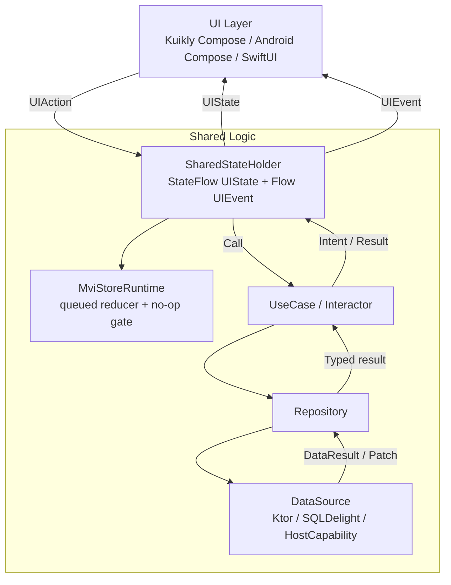

# Shared MVI Foundation

This document records the lightweight shared-state foundation used by Slock
KMP/common code. It is intentionally small: feature stores keep their own
business state and reducers, while the foundation enforces the contracts that
prevent state churn.

## Goals

- Keep business facts in shared stores, repositories, and data sources.
- Let UI render state and emit intents; UI must not own cache, realtime, API,
  token, header, or write-through timing.
- Serialize reducer application through one queue per store.
- Skip no-op state writes before emitting to `StateFlow`.
- Preserve stable row/list references when only one entity changes.
- Keep mutations idempotent with feature-owned action keys and in-flight guards.
- Map repository/data-source failures through typed `DataResult`, never raw JSON
  or platform exceptions.
- Log non-sensitive transitions so performance/debug investigations can prove
  whether a render was caused by a real state change.

## Foundation Types

`MviStoreRuntime<State, Intent>` owns:

- `state: StateFlow<State>`
- `dispatch(intent)` for async queue-backed intent processing
- `acceptQueued(intent)` for suspend callers that need a completion result
- `accept(intent)` for synchronous tests and already-serialized call sites
- an equality/no-op gate with `MviTransition`

`MviInFlightGuard` owns feature-level single-flight keys such as
`settings:server:delete` or `thread:mark-read:<threadId>`.

`MviEffectEmitter<Effect>` provides a small `SharedFlow` channel for one-off
effects such as navigation, toast, copy/share, permission prompt, or host
capability requests.

`MviStaleToken` is a tiny request-token primitive. Stores can increment or
replace tokens before starting async work, then ignore responses whose token is
not current.

`DataResult.failureCodeOrNull()` is the store-facing mapper for typed lower
boundary failures.

## Lower Boundary

The expected direction is:

```text
UI -> SharedStateHolder -> UseCase -> Repository -> DataSource/API/HostCapability
```

Repositories and data sources return typed domain snapshots, patches, or
`DataResult` failures. Host capabilities expose platform actions such as secure
store, notification permission, file picker, router, or open URL. They must not
become hidden state machines.

Repository and data source are deliberately separate:

- A repository is the domain-facing contract for a feature. It is where cache
  vs remote policy, write-through, realtime patch merge, no-op/diff decisions,
  and fallback behavior belong.
- A data source is a concrete external boundary: Ktor/API transport,
  SQLDelight/native database DAO, local KV store, or host capability.
- A feature that only has one remote call may temporarily have a thin
  repository implementation. That is a migration bridge, not a pattern to copy
  blindly. If a repository never owns policy, it should be collapsed back into
  the use case or replaced by a real repository when cache/realtime arrives.

Cache, realtime, and write-through events must re-enter through store/reducer
paths. They should not directly mutate UI collections or trigger a full page
reload when a narrow patch is enough.



## Library Survey

The current decision is to borrow proven ideas from KMP state libraries without
adopting a heavy framework in this migration slice.

- Orbit MVI exposes container state and side-effect flows through a
  `ContainerHost`; its docs treat side effects as one-off events such as
  navigation, analytics, or toasts. Source: <https://orbit-mvi.org/Core/> and
  <https://orbit-mvi.org/Core/architecture>.
- MVIKotlin models a store with `Intent`, `State`, and `Label`, and separates
  asynchronous business logic (`Executor`) from synchronous state mutation
  (`Reducer`). Source: <https://arkivanov.github.io/MVIKotlin/store.html>.
- Decompose focuses on KMP component/lifecycle/navigation ownership and exposes
  state streams with `Value`, keeping navigation out of UI-only code. Source:
  <https://arkivanov.github.io/Decompose/component/overview/>.
- Molecule can produce a `StateFlow` from Compose runtime state, but it requires
  the Compose compiler/runtime and is better treated as a presenter tool than as
  Slock's business-state source of truth. Source:
  <https://github.com/cashapp/molecule> and
  <https://cashapp.github.io/molecule/docs/latest/molecule-runtime/app.cash.molecule/launch-molecule.html>.
- Ballast is a KMP state-management framework with platform-agnostic
  coroutine/flow support and a repository layer concept. It is useful as a
  reference for long-lived repository boundaries, but it is too opinionated for
  this incremental migration. Source:
  <https://copper-leaf.github.io/ballast/wiki/platforms/> and
  <https://copper-leaf.github.io/ballast/wiki/modules/ballast-repository/>.

## What Slock Adopts

- Typed `Intent -> Reducer -> State` updates.
- One-off platform/UI outputs should be effects, not state fields that linger
  forever.
- Reducers are serialized and observable.
- No-op state writes are skipped before StateFlow emission.
- Store tests prove transition behavior, in-flight behavior, and typed failure
  mapping.
- Lifecycle/navigation stays outside reducers; reducers own only business state.

## What Slock Avoids For Now

- A whole-app framework migration in one step.
- Store base classes that force every feature into the same executor hierarchy.
- Compose-runtime state producers as canonical business facts.
- UI-layer debounce as a replacement for repository/write-through no-op gates.
- Raw API response, token, bearer header, or `X-Server-Id` access in UI code.

## Current Consumer

`SharedTasksViewModel` / `SharedTasksStore` is the first small consumer.

- `SharedTasksViewModel` implements `SharedStateHolder<TasksUiState,
  SharedTasksRouteIntent, SharedTasksEvent>`.
- UI dispatches `SharedTasksRouteIntent` as the UI action.
- The ViewModel calls `SharedTasksUseCase`.
- The use case reads selected session/server from `SlockAuthSessionStore` and
  calls `SharedTasksRepository`.
- `SharedTasksRepository` lives in `SharedTasksRepository.kt`.
- `SharedTasksDataRepository` is the current remote-only implementation. It
  delegates to `SharedTasksDataSource`, which remains the typed API/data-source
  boundary in `TasksDataSource.kt`.
- `TasksLoadRequest`, `TasksStatusUpdateRequest`, and `TasksCreateRequest` live
  in `TasksRequests.kt` so the use-case input contract is not hidden inside the
  store file.
- Store state emission still goes through `MviStoreRuntime`, keeping the reducer
  queue, no-op gate, and transition log.
- Mutation/load failures are mapped through typed `DataResult.failureCodeOrNull`
  and also exposed as one-off `SharedTasksEvent.OperationFailed` events.

Thread and Home already have proof slices for structural sharing/no-op behavior.
They should be migrated to the foundation in later focused tasks instead of
being rewritten broadly.
